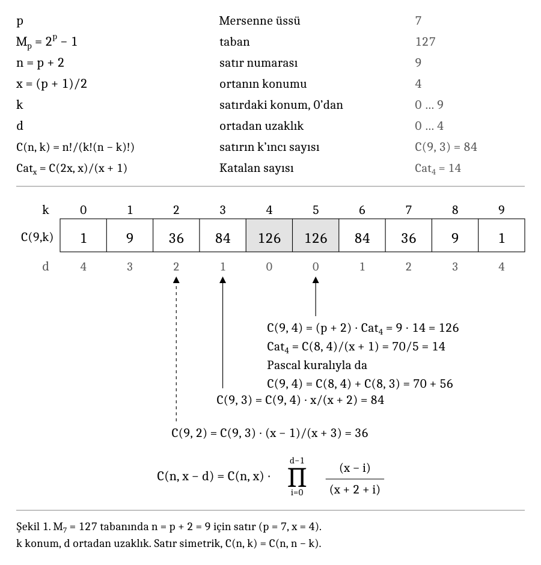

# Pascal ve Mersenne Tabanlarında Eldesiz Gösterim: N(p) Sınırı

James Augustus

[ORCID: 0009-0002-7286-7730](https://orcid.org/0009-0002-7286-7730)

## Öz

Bu çalışma, Pascal satırlarının Mersenne tabanında gösterimini ve sabit tabanda son eldesiz satırı belirleyen N(p) işlevini birlikte ele alır. İlk sonuç n = p + 2 satırını seçer. N(p) uzantısı aynı tabanda hangi satıra kadar ilerlenebileceğini belirler. Parametrelerin büyük olması, bütün hanelerin hesaplanmış veya saklanmış olduğu anlamına gelmez.

## Kapsam ve okuma düzeni

I. kısım gösterimin temelini, n = p + 2 sonucunu ve merkez katsayı ilişkilerini verir. II. kısım N(p) tanımını, on sayısal örneği, eşik dizisini, sınırları ve kanıtları içerir. III. kısım yazılımın kapsamını ve kayıtlı doğrulama sonucunu açıklar.

Bölüm numaraları ve numaralı atıflar kendi ana kısımları içinde okunur.

Kod ve testler eşlik eden depo arşivindedir. Metin CC BY 4.0, özgün kod MIT lisanslıdır. Üçüncü taraf bağımlılıkları kendi lisanslarını korur.

## I. Mersenne tabanında Pascal satırı

### 1. Kurulum

Her b tabanı için $(b+1)^n=\sum_{k=0}^{n}\binom{n}{k}b^{n-k}$. Katsayılar (b + 1)<sup>n</sup> sayısının b tabanındaki haneleri ancak her C(n,k) b'den küçükse oluyor, yani ortadaki katsayı b'den küçükse. 10 tabanında bu 11<sup>n</sup> için n ≤ 4'te tutuyor, n = 5'ten itibaren tutmuyor.

b = $M_p$ alıyorum; böylece b + 1 = 2<sup>p</sup> ve n = p + 2 oluyor. Üs buradan geliyor, (b + 1)<sup>n</sup> = `(2^p)^(p+2)` = $2^{p(p+2)}$. Burada p ≥ 2 bir tamsayıdır. Eldesiz yazım sonucu her p ≥ 7 tamsayısı için geçerlidir. Teorem 3 ve Sonuç 4'teki tek p durumu için n = 2x + 1 ve x = (p + 1)/2 alıyorum; iki orta katsayı C(n, x) = C(n, x + 1) olur.



### 2. Sonuçlar

**Teorem 1.** $\sum_{k=0}^{n}\binom{n}{k}M_p^{n-k}=2^{p(p+2)}$.

**Teorem 2.** Her p ≥ 7 tamsayısı için C(p + 2, ⌊(p + 2)/2⌋) < $M_p$. Bu yüzden p + 2'nci satırın her sayısı $M_p$ tabanında bir hanedir ve $2^{p(p+2)}$ $M_p$ tabanında o satır olarak yazılıyor.

**Teorem 3.** Tek p ≥ 7 için x = (p + 1)/2 olsun. C(2x + 1, x) = (2x + 1) $\mathrm{Cat}_x$, burada $\mathrm{Cat}_x=\frac{1}{x+1}\binom{2x}{x}$. Özellikle ortadaki hane (p + 2) $\mathrm{Cat}_{(p+1)/2}$ olur ve ikinci hane olan p + 2 onu böler.

**Sonuç 4.** Tek p ≥ 7 için (p + 3)/2 < q ≤ p + 2 olan her q asalı ortadaki haneyi tam bir kez böler. (p + 3)/2 asalsa ortadaki haneyi bölmez.

Örnek: p = 7. Taban 127, 2<sup>63</sup> = 128<sup>9</sup> sayısının haneleri 1, 9, 36, 84, 126, 126, 84, 36, 9, 1; 126 = 9 · 14 = 9 · $\mathrm{Cat}_4$. (p + 3)/2 = 5 asalı 126'yı bölmüyor.

### 3. Kanıtlar

*Teorem 1*, b = $M_p$ için binom teoremi.

*Teorem 2.* p'yi ikişer artırarak tek ve çift p üzerinde ayrı ayrı tümevarım yapıyorum. Tek p için başlangıç n = p + 2 = 9: C(9, 4) = 126 < 127 = M<sub>7</sub>. Adım için

$\frac{\binom{2x+3}{x+1}}{\binom{2x+1}{x}}=\frac{(2x+3)(2x+2)}{(x+1)(x+2)}=\frac{2(2x+3)}{x+2}<4$.

C(2x + 1, x) < $M_p$ ise C(2x + 3, x + 1) < 4 $M_p$ < 4 $M_p$ + 3 = $M_{p+2}$. Çift p için başlangıç p = 8: C(10, 5) = 252 < 255 = M<sub>8</sub>. n = 2x yazınca sonraki orta katsayı için

$\frac{\binom{2x+2}{x+1}}{\binom{2x}{x}}=\frac{2(2x+1)}{x+1}<4$.

Böylece $M_{p+2}$ = 4 $M_p$ + 3 ile aynı karşılaştırma çift p adımını da kanıtlar. İki tümevarım bütün p ≥ 7 tamsayılarını kapsar. p = 2, 3, 4, 5, 6 için orta katsayılar sırasıyla 6, 10, 20, 35, 70 olup 3, 7, 15, 31, 63 tabanlarını aşar.

*Teorem 3.* $\binom{2x+1}{x}=\frac{(2x+1)!}{x!(x+1)!}=(2x+1)\frac{(2x)!}{x!(x+1)!}=\frac{2x+1}{x+1}\binom{2x}{x}$.

*Sonuç 4.* Legendre formülüne göre q'nun C(n, x) içindeki üssü $v_q(n!)-v_q(x!)-v_q((x+1)!)$. x + 1 < q ≤ n ise n < 2q, yani v<sub>q</sub>(n!) = 1 ve öteki iki terim sıfır. q = x + 1 ise v<sub>q</sub>((x + 1)!) = 1 ve üs 0.

### 4. Hesaplar

Tablolar, 14 Ekim 2026 çalışma listesindeki 52 Mersenne asal üssü için merkez katsayı hesaplarını kaydediyor: p = 2, …, 136279841. Hesaplar gmpy2 ile yapıldı; ayrı bir kontrol betiği merkez katsayıları doğrudan gmpy2.comb ile yeniden hesapladı. Arşivdeki çıktısı 52 satır ve sıfır uyuşmazlık bildiriyor. İki hesap da GMP altyapısını kullandığı için bu, bağımsız bir aritmetik uygulamasıyla doğrulama değildir. Tarihsel kontrol merkez katsayıları ve tablo alanlarını kapsar; aşağıdaki komut satırı programlarıyla her Pascal satırını gezmek veya tam değerini kurmak değildir. Seçilmiş satırlar:

| p | ortadaki hanenin bit sayısı | $M_p$'nin bit sayısı | ortadaki hanenin onluk basamak sayısı |
|---|---|---|---|
| 7 | 7 | 7 | 3 |
| 13 | 13 | 13 | 4 |
| 31 | 31 | 31 | 10 |
| 127 | 126 | 127 | 38 |
| 521 | 519 | 521 | 156 |
| 1279 | 1276 | 1279 | 384 |
| 132049 | 132043 | 132049 | 39749 |
| 82589933 | 82589922 | 82589933 | 24862044 |
| 136279841 | 136279830 | 136279841 | 41024317 |

h(p) = $\frac12\log_2(\pi p/2)$ için logaritmik fark asimptotik olarak h(p) − 2 olur. Tamsayı bit uzunlukları ayrıca yuvarlamaya bağlıdır. 7 ≤ p ≤ 37 için p + 2'nci satır $M_p$ tabanındaki son temiz satır. p = 38'den itibaren p + 3'üncü satır da temiz.

### 5. Notlar

1. Asallığın bir rolü yok. Eldesiz satır sonucu her p ≥ 7 tamsayısı için geçerlidir; Teorem 3 ve Sonuç 4'te tek p koşulu korunur. Örneğin M<sub>11</sub> = 23 · 89 da temiz bir satır veriyor. Mersenne asal üslerini yalnızca deneme olarak kullandım.
2. Kullandığım parçalar standarttır: binom teoremi, Legendre formülü, Teorem 3'teki eşitlik ve 11'in kuvvetleri deseninin keyfi tabanlara genişletilmesi [2, 3]. b = $M_p$, n = p + 2 seçimini literatürde bulamadım, ama aramam kısaydı.
3. Haneler birbirinden üretilebiliyor, $R_{k+1}=R_k\frac{n-k}{k+1}$, ve değer Horner kuralıyla geri kuruluyor. Bu yineleme, büyüyen bir katsayıyı en çok n olan bir tamsayıyla çarpar ve tam bölme yapar; maliyetsiz değildir. Horner ile tam değeri kurmak ayrıca büyük tamsayı çarpmaları gerektirir.
4. Ortadaki hane Katalan sayısı kullanmadan, yalnız toplamayla da bulunuyor. Her satırın ortası, bir önceki satırın ortası ile komşusunun toplamı, C(9, 4) = C(8, 4) + C(8, 3) = 70 + 56. İlk formülümde Katalan sayısı vardı, sonra onu bu toplamalı biçime çevirdim.

### 6. Kod

`mersenne_rows.py` ve `mersenne_rows_gmp.c` (GMP'li C), satır katsayılarını üretir ve her katsayının tabandan küçük olup olmadığını `clean` ile bildirir. Satır yalnız p ≤ 20 için ekrana yazılır. Değer, üç aday asal modülden tabanla aralarında asal olanlarda $2^{p(p+2)}$ ile karşılaştırılır; `moduli=m/3` kullanılan modül sayısıdır. Tabanla ortak çarpanı olan modüller, boş bir doğrulama vermemek için atlanır. Kullanılabilir modül kalmazsa `value(mod)=unavailable`, `clean=unchecked` ve 1 çıkış kodu verilir; satır ve tam değer hesaplanmaz. `full` seçeneği ayrıca tam tamsayı eşitliğini karşılaştırır.

Değer kontrolleri, binom eşitliğinin uygulamadaki tutarlılığını sınar; bağımsız bir matematiksel kanıt veya asallık testi değildir. Gösterim açısından belirleyici koşul, en büyük katsayının tabandan küçük olmasıdır. Her iki program da n + 1 katsayıyı gezer; ekrana satır basılmaması bu işi ortadan kaldırmaz. `full` çıktısının bit uzunluğu p(p + 2) + 1'dir. Çok büyük üslerde bu satır taraması ve tam değer belleği pratik olmayabilir; merkez katsayısını doğrudan hesaplamak farklı bir iştir.

```
cc -O2 -o mersenne_rows_gmp mersenne_rows_gmp.c -lgmp
./mersenne_rows_gmp 7 full
./mersenne_rows_gmp 132049
```

`tr/tables/` klasöründe 52 üslük çalışmaya ait dört Türkçe tablo var. Teoremler ve kanıtları, ortadaki haneler, listedeki ilk 50 üssün ortadaki haneleri ve bunların çarpanları. p = 7, …, 61 için GMP'siz bir kontrol, yanındaki `ctcpu-hunter` deposunda `journal_tests.c` içindeki T21<sub>m</sub>ersenne<sub>r</sub>ow testi.

### Kaynaklar

1. Binom teoremi. https://mathworld.wolfram.com/BinomialTheorem.html
2. L. Jiu, C. Vignat, On binomial identities in arbitrary bases, J. Integer Sequences 19 (2016). https://arxiv.org/abs/1602.04149
3. M. S. Islam ve arkadaşları, Generating binomial coefficients in a row of Pascal's triangle from extensions of powers of eleven, Heliyon (2022). https://arxiv.org/abs/2005.14490
4. Legendre formülü. https://en.wikipedia.org/wiki/Legendre%27s<sub>f</sub>ormula
5. OEIS A001405 (orta binom katsayıları), A000108 (Katalan sayıları). https://oeis.org
6. GIMPS, bilinen Mersenne asalları listesi. https://www.mersenne.org/primes/

Metin CC BY 4.0, kod MIT.

## II. N(p): son eldesiz satır

### 1. Kurulum

Bu not boyunca p ≥ 2 bir tamsayıdır. Böylece M<sub>p</sub> geçerli bir konumsal tabandır. p veya M<sub>p</sub> asal olmak zorunda değildir. c(n) = C(n, ⌊n/2⌋), n'inci satırın en büyük sayısı olsun. Her b tabanı için (b + 1)<sup>n</sup> = Σ<sub>k=0</sub><sup>n</sup> C(n,k) b<sup>k</sup> ve katsayılar (b + 1)<sup>n</sup> sayısının b tabanındaki haneleri ancak c(n) < b ise oluyor. Tabanı b = M<sub>p</sub> olarak sabitleyip satırı değiştiriyorum:

N(p) = max{ n : c(n) < M<sub>p</sub> },  D(p) = N(p) − p,  h(p) = ½ log₂(πp/2).

Hata terimi E(p) = N(p) − p − h(p) olarak tanımlanır. Dolayısıyla N(p) = p + h(p) + E(p). Teorem B3, p ≥ 7 için −1 < E(p) ≤ E<sub>max</sub> sınırını verir.

Aşağıdaki Lemma 1'e göre temiz satırlar {0, 1, …, N(p)} başlangıç aralığını oluşturur. N(p), ilk başarısız satırda durarak bulunur. Ayrıca şunları kullanıyorum:

w(m) = 4<sup>m</sup> / C(2m, m) (m ≥ 1),  m<sub>k</sub> = min{ m : 2<sup>k</sup> C(2m, m) < 4<sup>m</sup> },  p<sub>k</sub> = 2m<sub>k</sub> − k − 1.

### Örnekler: N(p) ne işe yarar?

N(p), Pascal katsayılarını bir sayının haneleri olarak kullanırken geçerlilik sınırını verir. Taban seçilmişse hangi satıra kadar gidilebileceğini söyler. Ters yönde, belirli bir satırı elde taşımadan yazmak için yeterli tabanı seçmeye yardım eder. Aşağıdaki örnekler bu kullanımları gösterir. Bunlar yeni bir hız veya sıkıştırma sonucu değildir.

#### Örnek 1. Elle kontrol edilebilen bir sayı

p = 3 için taban 7'dir. Dördüncü Pascal satırı [1, 4, 6, 4, 1] olur. En büyük katsayı 6 < 7 olduğu için hepsi geçerli hanedir. Gerçekten

1 × 7<sup>4</sup> + 4 × 7<sup>3</sup> + 6 × 7<sup>2</sup> + 4 × 7 + 1 = 4096 = 8<sup>4</sup> = 2<sup>12</sup>.

Beşinci satır [1, 5, 10, 10, 5, 1] olur. 10, 7 tabanında hane değildir. Aynı katsayı açılımının değeri hâlâ 8<sup>5</sup> = 32768'dir, fakat gerçek haneler [1, 6, 4, 3, 5, 1] olur. Sağdaki 10, 3 kalanı ve 1 elde verir. Soldaki 10 bu eldeyle 11 olur, 4 kalanı ve 1 elde verir. Yanındaki 5 de 6 olur. Bu yüzden N(3) = 4. Buradaki p = 3 örneği tanımı açıklar, p ≥ 7 isteyen Teorem A'nın kapsamına girmez.

#### Örnek 2. Sınırdaki eşitlik de başarısızdır

p = 2 için taban 3'tür. İkinci satır [1, 2, 1] sığar. Üçüncü satır [1, 3, 3, 1] sığmaz, çünkü geçerli haneler yalnız 0, 1 ve 2'dir. Dolayısıyla N(2) = 2. Kontrol c(n) ≤ b değil, c(n) < b olmalıdır. Bir program bu eşitlik durumunu kabul ederse yanlış hane dizisi üretir.

#### Örnek 3. 127 tabanında bütün satırı görmek

p = 7 için taban 127'dir. 9. satır [1, 9, 36, 84, 126, 126, 84, 36, 9, 1] olur ve 2<sup>63</sup> sayısını gösterir. Merkez 126 < 127 iken bir sonraki satırın merkezi 252'dir. Böylece N(7) = 9 olur. Bu örnekte I. kısımdaki p + 2 seçimi sınıra tam ulaşır.

#### Örnek 4. Güvenli satırın ötesine geçmek

p = 38 için durum farklıdır:

| Satır | Merkez katsayısı | Taban 274877906943 ile karşılaştırma |
|---|---|---|
| 40 | 137846528820 | Küçük, haneler korunur |
| 41 | 269128937220 | Küçük, haneler korunur |
| 42 | 538257874440 | Büyük, elde gerekir |

N(38) = 41. Dolayısıyla p + 2 = 40 güvenli bir seçimdir, ama son geçerli seçim değildir. Bir dönüştürücü bu tabanda 41. satırı kabul edebilir, 42. satırın katsayılarını doğrudan hane diye kabul edemez.

#### Örnek 5. İstenen satır için taban seçmek

42\. satırı elde taşımadan yazmak istediğimizi düşünelim. Merkezi 538257874440'tır. p = 38 tabanı yetersizdir. p = 39 için taban 549755813887 olur ve merkez bu tabandan küçüktür. Bu nedenle Mersenne tabanları arasında yeterli en küçük p değeri 39'dur. N(39) = 42 olduğu da bir sonraki merkezin 1052049481860 olmasıyla doğrulanır.

Genel karar kuralı şudur: n satırı seçildiğinde c(n) < 2<sup>p</sup> − 1 sağlayan en küçük p ≥ 2 aranır. Bu, sabit p için N(p) bulma sorusunun tersidir. Bütün katsayıları ayrı ayrı sınamak yerine en büyüğünü sınamak yeterlidir.

#### Örnek 6. Bir milyon bitten uzun bir sayı

p = 1000 için taban b = 2<sup>1000</sup> − 1 ve son satır N(1000) = 1005'tir. Bu satırın başı ve sonu şöyledir:

[1, 1005, 504510, …, 504510, 1005, 1].

Bu gösterimde toplam 1006 hane vardır. Ortadaki … işareti sıfırları değil, burada yazılmayan 1000 Pascal katsayısını temsil eder. En büyük katsayı onluk yazımda 301 rakamlıdır. Bütün katsayılar tabandan küçüktür. Aynı hanelerin konum değerleriyle gösterdiği sayı 2<sup>1 005 000</sup> olur.

Bu sayı ikilik tabanda bir adet 1 ve arkasında 1 005 000 adet 0 ile yazılır. Dolayısıyla tam ikilik uzunluğu 1 005 001 bittir. Buradaki yarar, büyük bir sayının hangi Pascal satırıyla eldesiz temsil edilebildiğini kesin olarak bilmektir. Onluk gösterimin bütün rakamlarını basmaya gerek yoktur.

1006 hane kullanmak kendiliğinden veri sıkıştırması değildir. Her hane 1000 bite kadar yer isteyebilir. Hanelerin sayısı ile onları saklamak için gereken bit sayısı farklıdır.

#### Örnek 7. Ham ikilik yazımı yaklaşık 125 GB olan sayı

p = 1 000 000 seçilsin. Eşikler 667533 ≤ p < 2670166 olduğu için N(p) − p = 10 ve N(p) = 1 000 010 olur. Taban b = 2<sup>1 000 000</sup> − 1'dir.

[1, 1000010, 500009500045, …, 500009500045, 1000010, 1].

Satırda toplam 1 000 011 hane vardır. Gösterilmeyen orta bölüm 1 000 005 katsayı içerir. Temsil edilen sayı 2<sup>1 000 010 000 000</sup> ve tam ikilik uzunluğu 1 000 010 000 001 bittir.

Bu bitleri sıkıştırmadan, sekiz bitlik baytlar halinde saklamak 125 001 250 001 bayt, yaklaşık 125 GB gerektirir. Buna karşılık “2 üzeri 1 000 010 000 000” ifadesi kısa bir sembolik tanımdır. Sembolik tanım ile sayının bütün bitlerini belleğe açmak aynı işlem değildir. Bu örnekte bütün büyük sayı veya satır üretilmiş değildir. Son satır, matematiksel eşik sonucundan belirlenmiştir.

#### Örnek 8. Bir trilyon parametresi

p = 10<sup>12</sup> = 1 000 000 000 000 olsun. Bu ölçekte kısa bir tabloyu bütün satırları deneyerek üretmek yerine kanıtlanmış hata bandını kullanabiliriz. h(p) = ½ log₂(πp/2) için 20.257 < h(p) < 20.258 olur. Matematik notundaki −1 < E(p) ≤ 0.270575 sınırıyla

19.257 < N(p) − p < 20.529.

N(p) − p bir tamsayıdır. Bu aralıkta yalnız 20 vardır. Dolayısıyla N(p) = 10<sup>12</sup> + 20 = 1 000 000 000 020.

n = 10<sup>12</sup> + 20 yazarsak satırın düzeni [1, n, n(n − 1)/2, …, n(n − 1)/2, n, 1] olur. Toplam 10<sup>12</sup> + 21 hane vardır. Temsil edilen sayı 2<sup>10<sup>24</sup> + 20 × 10<sup>12</sup></sup> olur. Bu sonuç bütün katsayıların tek tek hesaplandığı anlamına gelmez. Son satırın hangi satır olduğuna, kanıtlanmış sınırın izin verdiği tek tamsayı seçilerek karar verilmiştir.

#### Örnek 9. p'nin kendisi 101 rakamlı olduğunda

Şimdi p = 10<sup>100</sup> olsun. Bu, onluk yazımda bir adet 1 ve ardından 100 adet 0 demektir. Taban b = 2<sup>10<sup>100</sup></sup> − 1 olur. h(p) için 166.422 < h(p) < 166.423 sınırları geçerlidir. Aynı hata bandı

165.422 < N(p) − p < 166.694

verir. Tek olası tamsayı 166'dır. Dolayısıyla N(10<sup>100</sup>) = 10<sup>100</sup> + 166 kesin olarak belirlenir.

n = 10<sup>100</sup> + 166 olmak üzere bu dev satır yine

[1, n, n(n − 1)/2, …, n(n − 1)/2, n, 1]

biçimindedir. Tam hane sayısı 10<sup>100</sup> + 167'dir. Temsil edilen sayı 2<sup>10<sup>200</sup> + 166 × 10<sup>100</sup></sup> olur. Başındaki ve sonundaki 1, Pascal satırının uçlarıdır. Aradaki … bilinmeyen veya keyfî değerler değil, n satırının burada yazılmayan belirli binom katsayılarıdır.

Bu örnekte N(p)'nin yararı özellikle açıktır: yazdırılması mümkün olmayan bir satır ailesinin eldesiz geçerlilik sınırını matematikle belirler. Satırın tamamını saklayabildiğimiz veya hesaplayıp ekrana döktüğümüz iddia edilmez.

#### Örnek 10. Programda kullanılabilecek sınır çiftleri

| p | N(p) | İlk eldesiz olmayan satır |
|---|---|---|
| 2 | 2 | 3 |
| 3 | 4 | 5 |
| 4 | 5 | 6 |
| 7 | 9 | 10 |
| 8 | 10 | 11 |
| 37 | 39 | 40 |
| 38 | 41 | 42 |
| 39 | 42 | 43 |
| 100 | 103 | 104 |
| 158 | 161 | 162 |
| 159 | 163 | 164 |
| 1000 | 1005 | 1006 |

Tablonun her satırı iki kontrol sunar: N(p) satırı sığmalı, N(p) + 1 satırı sığmamalıdır. Bu çiftler taban dönüşümü veya Pascal katsayılarını hane olarak kullanan bir programın sınır denetimlerinde işe yarar. p değişince taban da değişir. Tablodaki sıçramalar aynı tabanda satır atlandığı anlamına gelmez.

#### Kullanımın kapsamı

N(p), bu sayı gösteriminin kesin çalışma aralığını belirleyen matematiksel bir araçtır. Eğitimde elde taşımayı açıklamak, algoritmada doğru tabanı seçmek ve sınır durumlarını denetlemek için kullanılabilir. Bütün bir Pascal satırını veya çok büyük kuvveti üretmenin daha hızlı olduğunu tek başına göstermez. Ayrı bir şifreleme, genel sıkıştırma veya asallık testi sonucu sunmaz. N(p)'nin hesaplanmasının maliyeti de kullanılan yönteme bağlıdır.

### 2. Sonuçlar

**Teorem A.** Her p ≥ 7 tamsayısı için N(p) ≥ p + 2.

Bu sonuç I. kısım, Teorem 2 ile aynıdır.

**Teorem B1 (karakterizasyon).** Her p ≥ 7 ve her k ≥ 2 için N(p) − p ≥ k ancak ve ancak p ≥ p<sub>k</sub>. Dolayısıyla N(p) − p = max{ k : p<sub>k</sub> ≤ p }. p arttıkça azalmaz ve her p<sub>k</sub> noktasında tam 1 artar.

| k | m<sub>k</sub> | p<sub>k</sub> |
|---|---|---|
| 2 | 5 | 7 |
| 3 | 21 | 38 |
| 4 | 82 | 159 |
| 5 | 326 | 646 |
| 6 | 1304 | 2601 |
| 7 | 5215 | 10422 |
| 8 | 20861 | 41713 |
| 9 | 83443 | 166876 |
| 10 | 333772 | 667533 |
| 11 | 1335089 | 2670166 |
| 12 | 5340354 | 10680695 |

Yani N(p) − p değeri 7 ≤ p ≤ 37 için 2, 38 ≤ p ≤ 158 için 3, 159 ≤ p ≤ 645 için 4, 646 ≤ p ≤ 2600 için 5, 2601 ≤ p ≤ 10421 için 6, p = 10422'den p = 41712'ye kadar 7'dir.

**Teorem B2 (eşikler).** Her k ≥ 2 için

4<sup>k</sup>/π − 1/4 − 0.07/m<sub>k</sub> < m<sub>k</sub> < 4<sup>k</sup>/π + 3/4 + 1/(36(m<sub>k</sub> − 1)).

Dolayısıyla p<sub>k</sub> = (2/π)4<sup>k</sup> − k − 3/2 + 2φ<sub>k</sub> ve −0.07/m<sub>k</sub> < φ<sub>k</sub> < 1 + 1/(36(m<sub>k</sub> − 1)). Özellikle

2×4<sup>k</sup>/π − k − 1.53 < p<sub>k</sub> < 2×4<sup>k</sup>/π.

1 ≤ k ≤ 12 için m<sub>k</sub> = ⌈4<sup>k</sup>/π − 1/4⌉. Bu yüzden p<sub>k</sub> = 2⌈4<sup>k</sup>/π − 1/4⌉ − k − 1 ve 7 ≤ p ≤ 42 700 000 için N(p) − p = max{ k ≤ 12 : 2⌈4<sup>k</sup>/π − 1/4⌉ − k − 1 ≤ p }.

**Teorem B3 (hata bandı).** Her p ≥ 7 için

h(p) − 1 < N(p) − p ≤ h(p) + E<sub>max</sub>,

E<sub>max</sub> = 2 − h(7) = 0.270574474235… < 0.270575.

Tam üst sınır E<sub>max</sub> yalnız p = 7'de tutulur. 0.270575 dışa yuvarlanmış bir değerdir, tutulan bir uç nokta değildir. Alt değer −1 hiç tutulmaz ama ona istenildiği kadar yaklaşılır. N(p) − p = k ≥ 3 ise üst sınır şuna iner:

N(p) − p − h(p) < e(k) = −½ log₂(1 − (π/2)(k + 1.53)/4<sup>k</sup>),

e(3) < 0.0851, e(4) < 0.0250, e(5) < 0.0073, e(6) < 0.0021, e(7) < 0.00060. Tamsayı biçiminde: bir k için p<sub>k</sub> ≤ p < 2×4<sup>k</sup>/π ise N(p) − p = ⌊h(p)⌋ + 1, değilse N(p) − p = ⌊h(p)⌋. Her böyle pencerede k ile k + 2 arasında tamsayı vardır: 7 ile 10, 38 ile 40, 159 ile 162, 646 ile 651, 2601 ile 2607, 10422 ile 10430.

**Teorem B4 (oranlar).** Her k ≥ 2 için 3k − 5 < p<sub>k+1</sub> − 4p<sub>k</sub> < 3k + 6. Dolayısıyla p<sub>k+1</sub>/p<sub>k</sub> > 4 ve p<sub>k+1</sub>/p<sub>k</sub> → 4. Fark yaklaşık p<sub>k+1</sub>/p<sub>k</sub> − 4 ≈ 3πk/(2×4<sup>k</sup>).

| p<sub>k</sub> | p<sub>k+1</sub> | p<sub>k+1</sub> − 4p<sub>k</sub> | p<sub>k+1</sub>/p<sub>k</sub> |
|---|---|---|---|
| 38 | 159 | 7 | 4.184211 |
| 159 | 646 | 10 | 4.062893 |
| 646 | 2601 | 17 | 4.026316 |
| 2601 | 10422 | 18 | 4.006920 |
| 10422 | 41713 | 25 | 4.002399 |
| 41713 | 166876 | 24 | 4.000575 |
| 166876 | 667533 | 29 | 4.000174 |
| 667533 | 2670166 | 34 | 4.000051 |
| 2670166 | 10680695 | 31 | 4.000012 |

**Teorem C (eşik satırları).** k ≥ 3, p = p<sub>k</sub> ve N = N(p) olsun. N = 2m<sub>k</sub> − 1 tektir ve

1 − 1/(N + 1) ≤ c(N)/2<sup>p</sup> < c(N)/M<sub>p</sub> < 1.

Örneğin c(N)/M<sub>p</sub> değeri p = 38'de (N = 41) 0.979085, p = 159'da 0.995351, p = 646'da 0.999539, p = 2601'de 0.999826, p = 10422'de 0.999994.

### 3. Lemmalar

**Lemma 1 (monotonluk).** c(0) = c(1) = 1 ve her n ≥ 1 için c(n + 1) > c(n). Ayrıca her n için c(n + 1) ≤ 2c(n). Eşitlik c(n + 1) = 2c(n) tam olarak n tek iken tutar.

*Kanıt.* n = 2x için c(2x + 1)/c(2x) = (2x + 1)/(x + 1). Bu oran [1, 2) aralığındadır ve 1'e yalnız x = 0'da eşittir. n = 2x + 1 için Pascal kuralı ve simetriden c(2x + 2) = C(2x + 1, x) + C(2x + 1, x + 1) = 2c(2x + 1).

c(n + 1) = c(n) eşitliği yalnız n = 0'da olur. c(n + 1) = 2c(n) ise tam olarak n tek iken tutar.

**Lemma 2.** c(n) = 2<sup>q</sup> − 1 eşitliği yalnız n = 0, 1 (c = 1) ve n = 3 (c = 3) için tutar. Sonuç olarak n ≥ 4 için c(n) < 2<sup>p</sup> − 1 ancak ve ancak c(n) < 2<sup>p</sup>.

*Kanıt.* Çift n ≥ 2 için c(n) = 2c(n − 1) çifttir. n = 2x + 1 için c(n) = C(2x + 2, x + 1)/2 ve Legendre formülü v₂(C(2y, y)) = s₂(y) verir. s₂(y), y'nin ikilik yazımındaki 1 sayısıdır [3]. Gerçekten v₂(t!) = Σ<sub>j≥1</sub> ⌊t/2<sup>j</sup>⌋ = t − s₂(t) ve s₂(2y) = s₂(y). Bu yüzden c(n) ancak x + 1 ikinin kuvveti iken, yani n = 2<sup>M</sup> − 1 iken tektir. M ≥ 3 için

C(2<sup>M</sup> − 1, 2<sup>M−1</sup> − 1) = ∏<sub>i=1</sub><sup>K</sup> (2<sup>M</sup> − i)/i,  K = 2<sup>M−1</sup> − 1.

i = 2<sup>v</sup> u (u tek) yazınca çarpan (2<sup>M−v</sup> − u)/u olur. Pay ve payda tektir ve çarpan 2<sup>M−v</sup> modülünde −1'e denktir. i < 2<sup>M−1</sup> olduğundan v ≤ M − 2. v ≤ M − 3 olan çarpanlar 8 modülünde −1'dir. v = M − 2 olan tek çarpan i = 2<sup>M−2</sup> içindir ve değeri 3'tür. K tek olduğundan çarpım 8 modülünde (−1)<sup>K−1</sup> × 3 = 3 olur. Oysa q ≥ 3 için 2<sup>q</sup> − 1 ≡ 7 (mod 8). c(7) = 35 olduğundan M ≥ 3 durumu q ≥ 6 gerektirirdi. Geriye kalan M ≤ 2 durumları n = 0, 1, 3'tür.

**Lemma 3 (eşlik).** Her n ≥ 1 için 2<sup>n</sup>/c(n) = w(⌈n/2⌉). Ayrıca w(m + 1)/w(m) = 2(m + 1)/(2m + 1) > 1, yani w kesin artar.

*Kanıt.* n = 2m için tanımdır. n = 2m − 1 için Lemma 1'den C(2m, m) = 2C(2m − 1, m − 1), bu yüzden 2<sup>2m−1</sup>/C(2m − 1, m − 1) = 4<sup>m</sup>/C(2m, m). Oran, C(2m + 2, m + 1) = C(2m, m)(2m + 1)(2m + 2)/(m + 1)<sup>2</sup> eşitliğinden gelir.

Böylece 2<sup>n</sup>/c(n) yalnız çift satırdan sonraki tek satıra geçerken büyür, tek satırdan sonraki çift satıra geçerken değişmez.

**Lemma W.** Her m ≥ 1 için

π(m + 1/4 − 1/(36m + 3)) < w(m)<sup>2</sup> < π(m + 1/4 + 0.07/m).

*Kanıt.* Robbins'in Stirling formülü biçimi [2]: n! = √(2πn)(n/e)<sup>n</sup> e<sup>r<sub>n</sub></sup>, 1/(12n + 1) < r<sub>n</sub> < 1/(12n). (2m)! ve m! için uygulanınca w(m)<sup>2</sup> = πm e<sup>s</sup>, s = 2(2r<sub>m</sub> − r<sub>2m</sub>) ve

ms > (36m − 1)/(12(12m + 1)) = 1/4 − 1/(36m + 3),  ms < (18m + 1)/(72m + 3) = 1/4 + 1/(288m + 12).

e<sup>s</sup> > 1 + s. 0 < s < 1 için de e<sup>s</sup> < 1 + s + s<sup>2</sup>, çünkü üstel serinin kuyruğu en çok s<sup>2</sup>(e − 2)'dir. Burada s < 19/(75m), bu yüzden ms<sup>2</sup> < 0.0642/m ve 1/(288m + 12) + 0.0642/m < 0.07/m.

Satır bazında, θ hata terimi olmak üzere: çift n için (2<sup>n</sup>/c(n))<sup>2</sup> = (π/2)(n + 1/2 + θ), −2/(18n + 3) < θ < 0.28/n. Tek n için (2<sup>n</sup>/c(n))<sup>2</sup> = (π/2)(n + 3/2 + θ), −2/(18n + 21) < θ < 0.28/(n + 1). İki eşlik log₂ c(n) içinde yaklaşık 0.72/n kadar ayrılır. Bu küçük bir farktır ama eşik satırının hangisi olduğunu belirler (Teorem C).

### 4. Kanıtlar

*Teorem A.* Her n için c(n + 2)/c(n), n = 2x iken 2(2x + 1)/(x + 1) = 4 − 2/(x + 1), n = 2x + 1 iken 2(2x + 3)/(x + 2) = 4 − 2/(x + 2) olur. Yani c(n + 2) < 4c(n). Başlangıç durumları C(9, 4) = 126 < 127 = M<sub>7</sub> ve C(10, 5) = 252 < 255 = M<sub>8</sub>. c(p + 2) ≤ M<sub>p</sub> − 1 ise c(p + 4) < 4(2<sup>p</sup> − 2) = 2<sup>p+2</sup> − 8 < M<sub>p+2</sub>. Tek zincir p = 7'den, çift zincir p = 8'den başlar. Teorem A, p<sub>2</sub> = 7 olduğundan Teorem B1'den de çıkar.

*Teorem B1.* p ≥ 7 ve k ≥ 2 olsun. Böylece p + k ≥ 9. O zaman

N(p) − p ≥ k ⟺ c(p + k) < 2<sup>p</sup> − 1 (Lemma 1) ⟺ c(p + k) < 2<sup>p</sup> (Lemma 2) ⟺ w(⌈(p + k)/2⌉) > 2<sup>k</sup> (Lemma 3) ⟺ ⌈(p + k)/2⌉ ≥ m<sub>k</sub> ⟺ p ≥ 2m<sub>k</sub> − k − 1.

Lemma W'ye göre w sınırsızdır, bu yüzden m<sub>k</sub> vardır. w(m + 1)/w(m) oranı 2'den küçüktür. w(m<sub>k</sub> − 1) ≤ 2<sup>k</sup> olduğundan w(m<sub>k</sub>) < 2<sup>k+1</sup>, dolayısıyla m<sub>k+1</sub> ≥ m<sub>k</sub> + 1 ve p<sub>k+1</sub> > p<sub>k</sub> olur.

*Teorem B2.* w(m<sub>k</sub>)<sup>2</sup> > 4<sup>k</sup> ve Lemma W'nin üst sınırından 4<sup>k</sup>/π < m<sub>k</sub> + 1/4 + 0.07/m<sub>k</sub>. w(m<sub>k</sub> − 1)<sup>2</sup> ≤ 4<sup>k</sup> ve alt sınırdan m<sub>k</sub> − 3/4 − 1/(36m<sub>k</sub> − 33) < 4<sup>k</sup>/π. Bunlar p<sub>k</sub> = 2m<sub>k</sub> − k − 1 içine konur. k ≥ 2 için m<sub>k</sub> ≥ 5. Elde edilen daha geniş aralık her zaman ⌈4<sup>k</sup>/π − 1/4⌉ sayısını içerir. İkinci bir tamsayıyı ancak 4<sup>k</sup>/π − 1/4 sayısının kesir kısmı 0.07/m<sub>k</sub>'den küçük ya da 1 − 1/(36(m<sub>k</sub> − 1))'den büyükse içerebilir. k ≤ 12 değerleri tam olarak hesaplandı (Bölüm 5). p<sub>13</sub> > 2×4<sup>13</sup>/π − 14.53 > 42 722 815 olduğundan N(p) için kapalı biçim 42 700 000'e kadar geçerlidir.

*Teorem B3.* N(p) − p = k olsun, yani p<sub>k</sub> ≤ p < p<sub>k+1</sub>. Alt sınır: p < p<sub>k+1</sub> < 2×4<sup>k+1</sup>/π, bu yüzden πp/2 < 4<sup>k+1</sup> ve h(p) < k + 1. Üst sınır: p > 2×4<sup>k</sup>/π − k − 1.53, bu yüzden πp/2 > 4<sup>k</sup>(1 − (π/2)(k + 1.53)/4<sup>k</sup>). Logaritma alınınca e(k) çıkar. k = 2 platosunda p ≥ 7 kullanılır ve değer 2 − h(7) olur. e(k) azaldığı ve e(3) < 0.0851 < 2 − h(7) olduğu için genel en büyük değer 2 − h(7)'dir. Plato içinde h arttığından uç değerler p = p<sub>k</sub> ve p = p<sub>k+1</sub> − 1 noktalarındadır. İkincisi Teorem B2'ye göre −1'e gider. Tamsayı biçimi için: platoda h(p) değeri (k − e(k), k + 1) aralığındadır ve h(p) ≥ k ancak ve ancak p ≥ 2×4<sup>k</sup>/π.

Pencere sayımı için T<sub>k</sub> = 2×4<sup>k</sup>/π yazılır. Pencerede ⌈T<sub>k</sub>⌉ − p<sub>k</sub> = k + 1 + ⌈1/2 − 2φ<sub>k</sub>⌉ tamsayı vardır. B2 sınırları k ≥ 2 için −1.514 < 1/2 − 2φ<sub>k</sub> < 0.528 verir. Son tavan değeri −1, 0 veya 1 olduğundan sayı k ile k + 2 arasındadır.

*Teorem B4.* Teorem B2, k ve k + 1 için yazılınca p<sub>k+1</sub> − 4p<sub>k</sub> = 3k + 7/2 + 2φ<sub>k+1</sub> − 8φ<sub>k</sub> olur. m<sub>2</sub> = 5 ve m<sub>3</sub> = 21 olduğundan bu değer 3k + 3.5 − 0.03 − 8.06 > 3k − 5 değerinin üstünde, 3k + 3.5 + 2.01 + 0.12 < 3k + 6 değerinin altındadır. k ≥ 2 için 3k − 5 > 0. p<sub>k</sub> > 2×4<sup>k</sup>/π − k − 1.53 olduğundan (3k + 6)/p<sub>k</sub> → 0.

*Teorem C.* p = p<sub>k</sub> için N(p) = p + k ve N(p − 1) = N − 2. Bu yüzden c(N − 1) ≥ 2<sup>p−1</sup> − 1 ve Lemma 2'den c(N − 1) ≥ 2<sup>p−1</sup>. N çift olsaydı c(N) = 2c(N − 1) ≥ 2<sup>p</sup> > M<sub>p</sub> olurdu. Çelişki. N = 2x + 1 için c(N) = c(2x)(2x + 1)/(x + 1) ≥ 2<sup>p−1</sup>(2 − 1/(x + 1)) = 2<sup>p</sup>(1 − 1/(N + 1)). Teorem B1'den doğrudan N = p<sub>k</sub> + k = 2m<sub>k</sub> − 1.

### 5. Hesaplar

Ekteki [doğrulayıcı](../../tests/verify_np.py) ifadelerin sonlu örneklerini sınar. Deponun kökünde Python 3.10 veya sonrası yeterlidir:

```sh
python3 -B tests/verify_np.py --quick
python3 -B tests/verify_np.py
```

Normal koşu 7 ile 20000 arasındaki her p'yi sınar. Hızlı koşu p = 1000'de durur ve normal koşunun yerine geçmeyen kısa bir kontroldür. `--json PATH` verilmedikçe iki kip de dosya yazmaz.

| Kontrol | Normal koşu | Hızlı koşu |
|---|---|---|
| Yineleme ve math.comb ile merkez katsayıları | n = 0..20012 | n = 0..1012 |
| N(p), Teorem A, hata sınırları ve eşik karakterizasyonu | p = 7..20000 | p = 7..1000 |
| N(p) için yalnız toplama kullanan Pascal karşılaştırması | p = 7..128 | p = 7..128 |
| Lemma W | m = 1..10006 | m = 1..506 |
| m<sub>k</sub> için doğrudan tarama | k = 1..8 | k = 1..8 |
| Kesin eşik sınırı kontrolleri | k = 1..12 | k = 1..8 |
| Özel kalan c(2<sup>M</sup> − 1) modulo 8 | M = 3..20 | M = 3..12 |
| Oran sınırları | k = 2..11 | k = 2..7 |
| Eşik satırı sınırları | k = 3..12 | k = 3..8 |

Karşılaştırmalar Python tamsayılarıyla yapılır. Machin özdeşliği π = 16 arctan(1/5) − 4 arctan(1/239), her terimin kesme hatasını hesaba katarak rasyonel bir aralık verir. Ölçek 10<sup>90</sup>'dır ve toplam aralık genişliğinin 10<sup>−80</sup>'den küçük olduğu kontrol edilir. π içeren her karşılaştırmada bu aralık karar vermeye yeterli olmalıdır. Yetmezse program tahmin etmek yerine hata verir. Bilinen 50 basamakla uyum yalnız ek kontroldür, aralığın gerekçesi değildir.

Her eşik adayı için hem 2<sup>k</sup> C(2m<sub>k</sub>,m<sub>k</sub>) < 4<sup>m<sub>k</sub></sup> hem de m<sub>k</sub> − 1'de bu sıkı eşitsizliğin sağlanmaması kontrol edilir. Tarama sınırının üstünde adayı tavan ifadesi önerir, fakat aday ancak kesin sınır kontrollerinden sonra kabul edilir. Genel üst hata sınırı, logaritmasız olarak 7×4<sup>D(p)−2</sup> ≤ p biçiminde sınanır. Logaritmalar yalnız yaklaşık uç değerleri göstermek için Decimal ile hesaplanır, bir kontrolün geçmesine karar vermez.

Normal aralıkta D(p), 38, 159, 646, 2601 ve 10422'de değişir. D(p) − h(p) hatası p = 7'de yaklaşık 0.270574 ile en büyük, p = 10421'de yaklaşık −0.999351 ile en küçüktür. [Kayıtlı sonuç](../../tests/np_verification.json), gerçek koşu kapsamını ve kontrol sayısını verir. Normal koşu bütün kontroller geçtikten sonra 0 çıkış kodu döndürür. Süre makineye bağlıdır, özellikle k = 12'deki büyük kesin binom katsayıları süreyi belirler.

Bunlar sonlu hesap kontrolleridir. Yineleme, math.comb ve yalnız toplama kullanan karşılaştırma aynı Python tamsayı uygulamasını kullanır, bağımsız aritmetik altyapıları değildir. Genel ifadeler kanıtlara dayanır. Bütün k değerleri için tavan formülü açık kalır.

### 6. Açık soru

p<sub>k</sub> = 2⌈4<sup>k</sup>/π − 1/4⌉ − k − 1 eşitliğinin her k için tuttuğu KANITLANMADI. 4<sup>k</sup>/π − 1/4 sayısının kesir kısmı hiçbir zaman bir tamsayıya yaklaşık 4<sup>−k</sup> kadar yaklaşmazsa eşitlik çıkar. π hakkında bunu çözen bir sonuç bilmiyorum. Teorem B1, B2, B3, B4 ve C buna dayanmıyor. Stirling serisinin daha fazla terimi istisna bandını daraltır ama ortadan kaldırmaz.

### 7. Notlar

1. Aynı eldesiz yazım ilkesi Islam ve ark. (2022) [4] çalışmasında da kullanılıyor. Onlar verilen bir n satırı için b = 10<sup>d</sup> tabanını seçiyor. d, c(n)'nin onluk basamak sayısıdır, böylece b > c(n) olur ve satır (b + 1)<sup>n</sup> sayısının bloklarından okunur. c(n) < b koşulu burada kullanılanla aynıdır. Onların çalışması satırı sabitleyip tabanı büyütüyor. Bu not tabanı M<sub>p</sub> olarak sabitleyip en büyük satırı soruyor. Jiu ve Vignat [5], b-ary binom katsayılarıyla ilişkili sayısal binom özdeşliklerini inceler. Bu nesneler burada kullanılan normal binom katsayılarından farklıdır ve bu kanıtlarda o makalenin bir teoremi kullanılmaz. 2019 düzeltmesi de kaynakla birlikte bağlıdır.
2. Kullanılan parçalar Pascal kuralı, Legendre formülü, Robbins sınırları ve temel eşitsizliklerdir. Lemma 2, c(2<sup>M</sup> − 1) ≡ 3 (mod 8) için kısa modüler kanıtı içerir. Bu bir öncelik iddiası değildir.
3. N(p) ≈ p + ½ log₂(πp/2) yaklaşımı p + ½ log₂(πp/2) + sabit + o(1) biçimine keskinleştirilemez: N(p) − p bir tamsayıdır ve N(p) − p − h(p) her platoda yaklaşık 0'dan neredeyse −1'e iner.
4. I. kısım, p = 38'den itibaren p + 3'üncü satırın da temiz olduğunu söylüyor. Teorem B1 bu ifadeyi her k için genişletiyor.

### Kaynaklar

1. J. Augustus, [I. kısım](#i-mersenne-tabanında-pascal-satırı), bu çalışmanın I. kısmı.
2. H. Robbins, A remark on Stirling's formula, Amer. Math. Monthly 62 (1955), sayı 1, s. 26 ile 29. https://doi.org/10.2307/2308012
3. K. Conrad, [Proofs of integrality of binomial coefficients](https://kconrad.math.uconn.edu/blurbs/proofs/binomcoeffintegral.pdf), Bölüm 5, Legendre faktöriyel değerleme formülü.
4. M. S. Islam, M. R. Islam, M. S. Hossan, M. H. Kibria, Generating binomial coefficients in a row of Pascal's triangle from extensions of powers of eleven, Heliyon 8 (2022), sayı 11, e11651. https://doi.org/10.1016/j.heliyon.2022.e11651, ön baskı https://arxiv.org/abs/2005.14490
5. L. Jiu, C. Vignat, On binomial identities in arbitrary bases, J. Integer Sequences 19 (2016), makale 16.5.5. [Makale](https://cs.uwaterloo.ca/journals/JIS/VOL19/Jiu/jiu3.pdf), [2019 düzeltmesi](https://cs.uwaterloo.ca/journals/JIS/VOL19/Jiu/jiu3-corrigendum.pdf).
6. [OEIS A001405](https://oeis.org/A001405), dizi kaynağı olarak merkez katsayıları C(n,⌊n/2⌋).

Metin CC BY 4.0, kod MIT.

## III. Yazılım ve doğrulama kapsamı

`mersenne_rows.py` ve `mersenne_rows_gmp.c`, seçilen n = p + 2 satırını üretir. `tests/verify_np.py`, N(p) sonuçları için ayrı sonlu kontroller yürütür. Kaydedilmiş tam koşuda 260.608 kontrol vardır. Bu tarihsel tam koşu, her yeni belge düzenlemesinde tekrar yapılmış gibi sunulmaz. Hızlı koşunun kapsamı p ≤ 1000'dir. Tam koşu p ≤ 20000 ve eşik k ≤ 12 sınırlarını kullanır.

```sh
python3 -B tests/verify_np.py --quick
python3 -B -m unittest discover -s tests -p 'test_*.py'
```

Sonlu testler matematiksel kanıtın yerine geçmez. `full` seçeneği tam değeri kurar ve büyük girdilerde bellek maliyeti artar. Bir katsayıyı hesaplamak, bütün satırı üretmek ve bütün sayının değerini kurmak ayrı görevlerdir. Eski PCCPU örnekleri arşivde bulunabilir. Mimari geliştirmelerin asıl açıklaması CTCPU-Hunter çalışmasındadır.

[Kaynak depo](https://github.com/JamesAugustus/pascal-mersenne-rows) ve [ilgili mimari çalışma](https://github.com/JamesAugustus/ctcpu-hunter).
